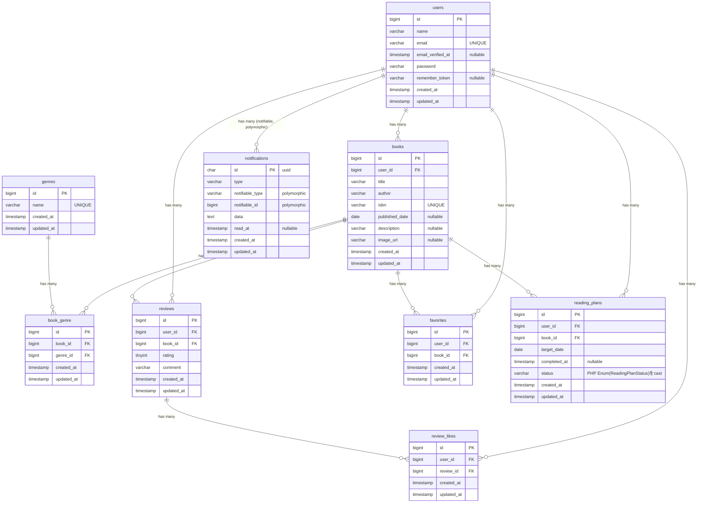

# BookShelf 書籍レビューアプリ

## 概要

本アプリケーションは、書籍の登録・一覧表示・詳細表示と、ログインユーザーによるレビューの投稿・編集・削除を提供するWebアプリケーションです。
会員登録とログインにはLaravel Fortifyを使用しています。

## 作成者

溝口　竣介

## 使用技術

- PHP 8.5
- Laravel 10.x
- MySQL 8.4
- Vite
- Tailwind CSS 3.4
- @tailwindcss/forms
- Alpine.js
- Laravel Fortify
- Laravel Sanctum
- Docker / Laravel Sail
- phpMyAdmin
- PHPUnit 10.x
- Git / GitHub

## ER図



## 開発環境URL

- 開発環境：http://localhost
- phpMyAdmin：http://localhost:8080

## 動作環境

本アプリケーションは**Docker（Laravel Sail）**を利用して動作します。

## 環境構築手順

1. **リポジトリをクローン**

    リポジトリをクローンします。
    ```bash
    git clone git@github.com:shunsukem1993-a11y/bookshelf-app.git
    ```
    クローンしたプロジェクトディレクトリに移動します。
    ```bash
    cd bookshelf-app
    ```

2. **.envファイルの準備**
    
    .env.exampleをコピーして.envファイルを作成します。
    ```bash
    cp .env.example .env
    ```

    .envのデータベース設定が以下になっていることを確認してください。

    ```env
    DB_CONNECTION=mysql
    DB_HOST=mysql
    DB_PORT=3306
    DB_DATABASE=laravel
    DB_USERNAME=sail
    DB_PASSWORD=password

3. **Composer依存パッケージのインストール**

    Composerで依存パッケージをインストールします。
    ```bash
    docker run --rm \
    -u "$(id -u):$(id -g)" \
    -v "$(pwd):/var/www/html" \
    -w /var/www/html \
    -e COMPOSER_CACHE_DIR=/tmp/composer_cache \
    laravelsail/php82-composer:latest \
    composer install --ignore-platform-reqs
    ```

4. **Laravel Sailの起動**

    Dockerコンテナを起動します。
    ```bash
    ./vendor/bin/sail up -d
    ```

5. **アプリケーションキーの生成**

    Laravelのアプリケーションキーを生成します。
    ```bash
    ./vendor/bin/sail artisan key:generate
    ```

6. **データベースのマイグレーションと初期データ投入**

    テーブルを作成し、シーダーを実行します。
    ```bash
    ./vendor/bin/sail artisan migrate --seed
    ```

7. **フロントエンドのビルド**

    Node.jsの依存パッケージをインストールし、開発用ビルドを実行します。
    ```bash
    ./vendor/bin/sail npm install
    ./vendor/bin/sail npm run dev
    ```

8. **アプリケーションへのアクセス**

    ブラウザで以下のURLにアクセスします。
    ```bash
    http://localhost
    ```

## テスト実行

PHPUnitによるテストを実行する場合は、以下のコマンドを実行してください。
```bash
./vendor/bin/sail test
```

特定のテストファイルのみを実行する場合は、以下のように指定できます。
```bash
./vendor/bin/sail artisan test --filter=テストファイル名
```

例：
```bash
./vendor/bin/sail artisan test --BookIndexTest
```

## 機能一覧

### 認証機能
- 会員登録機能（Laravel Fortify）
- ログイン・ログアウト機能（Laravel Fortify）
- APIトークン認証機能（Laravel Sanctum）
- バリデーション機能（FormRequest、日本語エラーメッセージ）

### 書籍機能
- 書籍登録機能（タイトル・著者・ISBN・発行日・紹介文・画像URL・ジャンル）
- 書籍一覧表示機能（キーワード検索・ジャンル絞り込み・並び替え・ページネーション、ゲストも閲覧可）
- 書籍詳細表示機能（ゲストも閲覧可）
- 書籍編集機能（登録者本人のみ）
- 書籍削除機能（登録者本人のみ）
- ISBN検索機能（Google Books API連携による登録・編集フォームの自動入力）

### ジャンル機能
- ジャンル登録機能
- ジャンル一覧表示機能（紐づく書籍数を表示）
- ジャンル詳細表示機能（紐づく書籍一覧、ページネーション）
- ジャンル編集機能
- ジャンル削除機能（書籍が紐づいている場合は削除不可）

### レビュー機能
- レビュー投稿機能（評価・コメント、1冊に複数回投稿可）
- レビュー編集機能（投稿者本人のみ）
- レビュー削除機能（投稿者本人のみ）
- レビューいいね機能（登録・解除の切り替え）

### お気に入り機能
- お気に入り登録・解除機能（切り替え）
- お気に入り一覧表示機能（登録日時の新しい順）

### ランキング機能
- 書籍ランキング表示機能（レビュー平均評価TOP10、ゲストも閲覧可）

### マイ読書レポート機能
- 読書レポート表示機能（ログインユーザー自身のレビューを集計）
- 基本サマリー集計機能（総レビュー数・読了冊数・平均評価点）
- 評価分布集計機能（1〜5星ごとの件数）
- 高評価書籍TOP5表示機能
- ジャンル別評価傾向TOP5表示機能

### 読書計画機能
- 読書計画登録機能（同一書籍への進行中計画の重複登録を防止）
- 読書計画一覧表示機能（状態による絞り込み）
- 読書計画編集機能（作成者本人かつ未完了のみ）
- 読書計画削除機能（作成者本人のみ）
- 読書計画の読了（完了）機能
- 読書計画の期限切れ自動判定機能（日次バッチ）
- 読書計画リマインダー通知機能（期日3日前・当日・3日後、重複送信防止）

### 通知機能
- 通知一覧表示機能（本人の通知のみ、新しい順）
- 通知既読機能（本人の通知のみ）

### REST API機能（書籍レビューAPI）
- 書籍一覧取得API（認証不要）
- 書籍詳細取得API（認証不要）
- 書籍登録API（Sanctumトークン認証必須）
- 書籍更新API（Sanctumトークン認証必須・所有者のみ）
- 書籍削除API（Sanctumトークン認証必須・所有者のみ）

### 認可・アクセス制御
- 認証必須画面の制御（未認証時はログイン画面へリダイレクト）
- 所有者本人のみ操作可能な制御（Policyによる認可：書籍・レビュー・読書計画）
- APIにおけるSanctumトークン認証・認可制御（所有者のみ更新・削除可能）

### その他
- 外部API連携機能（Google Books API、Httpファサード使用）
- 日次バッチ処理機能（Schedule・Console Command）
- Service層による業務ロジックの分離（書籍登録・更新、マイ読書レポート集計）
- ダミーデータ作成機能（Seeder・Factory）
- PHPUnitによるテスト（Feature／Unit）

## APIエンドポイント一覧

本アプリケーションで提供している主なREST APIの一覧です。

書籍レビューAPI

| HTTPメソッド | URI | 概要 | 認証| 認証・認可 |
| ---------- | ---------------------------------------------- | ------ | --------- | --------------------------------------- |
| GET | /api/v1/books | 書籍一覧を取得する | 不要 | 不要 |
| GET | /api/v1/books/{book} | 書籍詳細を取得する | 不要 | 不要 |
| POST | /api/v1/books | 書籍を新規登録する | Sanctum認証必須 | Sanctum |
| PUT / PATCH | /api/v1/books/{book} | 書籍を更新する | Sanctum認証必須 | Sanctum + BookPolicy（所有者のみ） |
| DELETE | /api/v1/books/{book} | 書籍を削除する | Sanctum認証必須 | Sanctum + BookPolicy（所有者のみ） |
